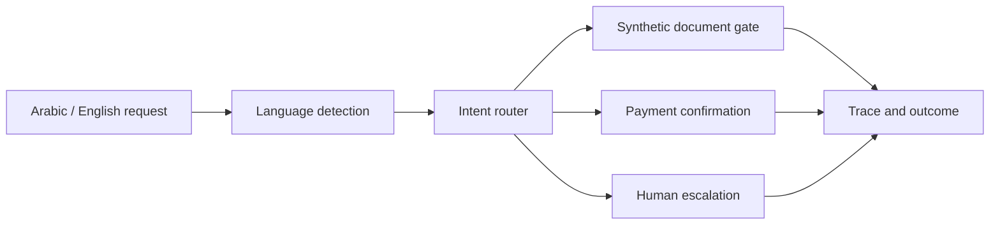
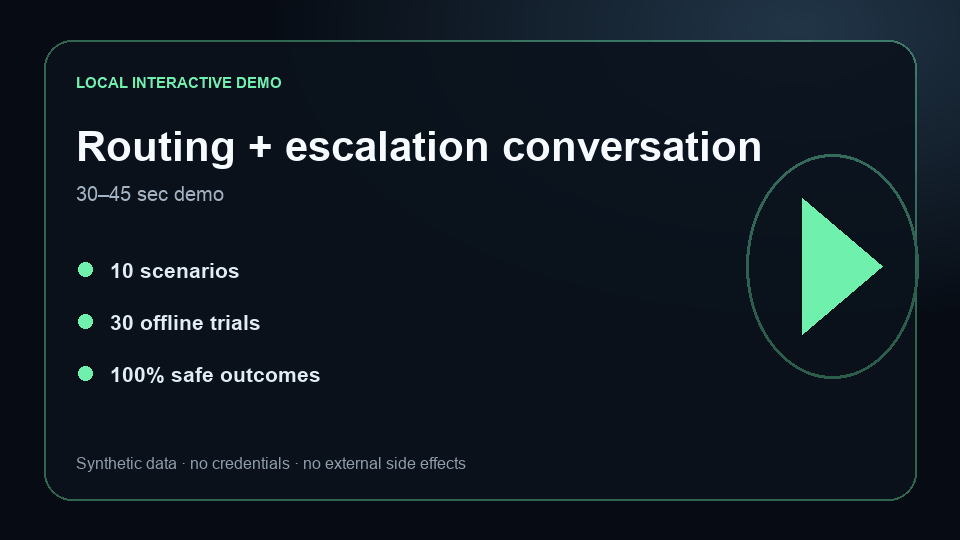

# Multilingual Agentic Contact Center

[](https://github.com/AbuElNour/multilingual-agentic-contact-center/actions/workflows/ci.yml)
[](https://github.com/AbuElNour/multilingual-agentic-contact-center/actions/workflows/codeql.yml)
[](LICENSE)

**Problem:** multilingual service agents can misroute Arabic/English requests, proceed without required documents, treat payment language as consent, or trap unsupported cases in automation.
**Result:** this credential-free reference passes 30/30 deterministic trials across 10 domain scenarios and safely escalates complaints and unsupported intents.
**Architecture:** language detection feeds an intent router, then explicit document, confirmation, and human-handoff policies determine the outcome and trace.
**My contribution:** I designed and implemented the bilingual routing state, synthetic document boundary, payment approval gate, escalation policy, trace model, evaluator, tests, and local conversation viewer.



## Five-minute quickstart

```bash
make test
make eval
make demo
```

Python 3.11+ is the only requirement. No provider account, real document, or network request is used.

## Local Arabic/English routing demo

[](#run-the-browser-demo)

### Run the browser demo

```bash
python3 -m http.server 8080 -d demo
```

Open `http://127.0.0.1:8080` and choose English renewal, Arabic payment, complaint, or unsupported intent. The viewer exposes `language.detected`, `intent.routed`, `document.gate`, `policy.applied`, and the final safe outcome. The release video remains gated until release acceptance completes.

## Evaluation evidence

| Scenario family | Expected boundary |
|---|---|
| English and Arabic renewal | Required synthetic document fields |
| English and Arabic payment | Explicit confirmation required |
| Complaint | Human escalation |
| Unknown intent | Human escalation |

`make eval` executes 10 representative tasks three times through code graders and regenerates `evals/results.json`. Pull-request CI runs all deterministic tests and evaluations without paid credentials.

| Gate | Current result |
|---|---:|
| Domain scenarios | 10 |
| Deterministic trials | 30 |
| Overall success | 100% |
| Payment approval and escalation | 100% |

This supporting reference does not publish provider-backed model comparisons; its evidence is explicitly deterministic regression behavior.

## Security boundaries

| Boundary | Enforcement |
|---|---|
| Identity | Uses a non-identifying synthetic `holder_alias` |
| Documents | Renewal stops when required fields are absent |
| Payment | Payment always returns `approval_required` |
| Complaints | Escalate to a human specialist |
| Unsupported intent | Fail closed to human escalation |
| Data | Services, documents, identities, and payments are synthetic |

See [SECURITY.md](SECURITY.md) for reporting and repository rules.

## Failure analysis

**Failure mode:** an unsupported request can be forced into the nearest known intent and produce a confident but unsafe automated answer.
**Engineering improvement:** the router has an explicit `unknown` intent that always escalates, with deterministic English and Arabic cases and a regression test.

The evaluator separates language, intent, document, approval, and escalation failures so a passing aggregate cannot hide a broken safety boundary.

## What is mocked

Organizations, services, identities, documents, payments, and human-escalation cases are synthetic. No customer branding, government endpoint, real identifier, or external side effect is present.

## Known limitations

- Language and intent routing are deterministic keyword rules, not a production NLU benchmark.
- Document checks validate required synthetic fields, not authenticity.
- The local handoff records an outcome but does not contact a live queue.
- Production use requires identity, localization, accessibility, privacy, and end-to-end quality evaluation.

See [PROVENANCE.md](PROVENANCE.md) for the clean-history publication boundary.
