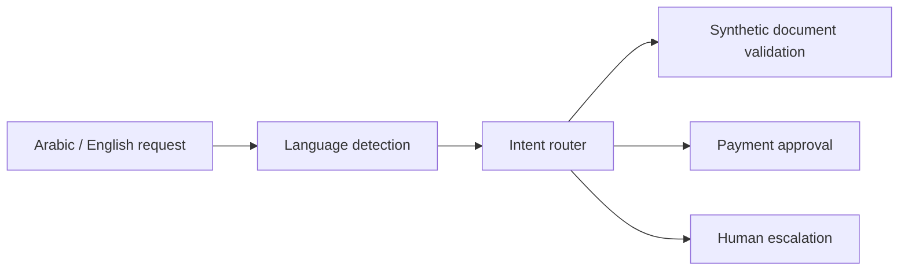

# Multilingual Agentic Contact Center

> A synthetic Arabic/English contact-center agent demonstrating language detection, intent routing, document gates, payment approval, and human escalation.



## Quickstart

```bash
make test
make eval
make demo
```

## What I built

- English and Arabic routing.
- Structured document requirements without real identifiers.
- Mandatory approval before payment.
- Safe escalation for complaints and unsupported intents.
- Ten scenarios across 30 deterministic trials.

## What is mocked

Services, documents, identities, payments, and escalation cases are synthetic. The demo makes no network request.

## Known limitations

Keyword-based language and intent routing demonstrates orchestration boundaries, not production natural-language accuracy.

The reference contains no client branding or production data. See [SECURITY.md](SECURITY.md) and [PROVENANCE.md](PROVENANCE.md).
